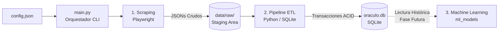
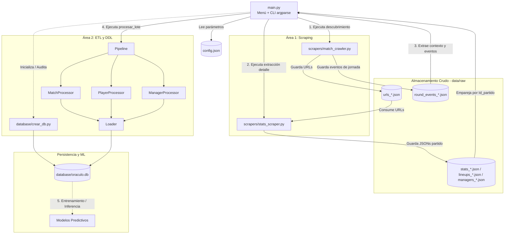
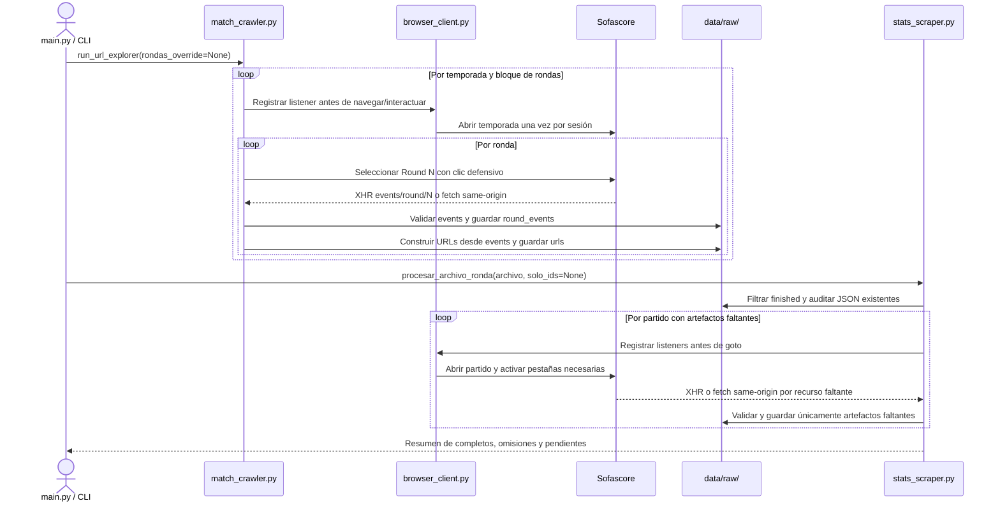
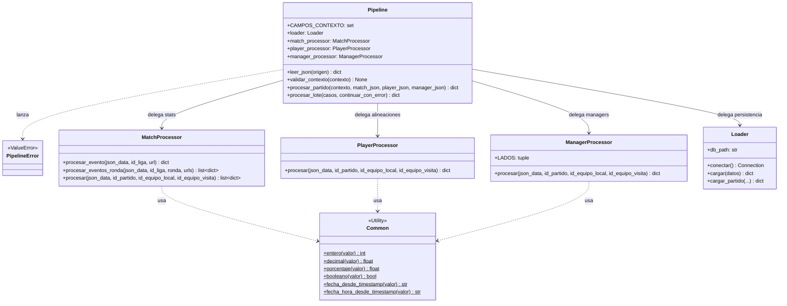
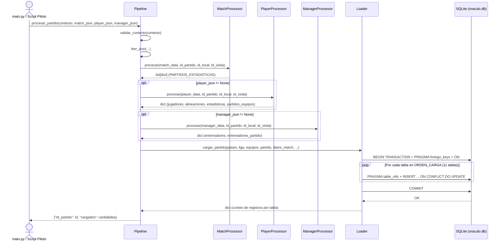

# Arquitectura del Sistema y Diseño Técnico

## Índice de Navegación
1. [Visión Arquitectónica General](#1-visión-arquitectónica-general)
2. [Estructura de Directorios del Proyecto](#2-estructura-de-directorios-del-proyecto)
3. [Flujo General de Componentes y Orquestación (`../main.py`)](#3-flujo-general-de-componentes-y-orquestación-mainpy)
4. [Detalle Técnico — Área 1: Scraping](#4-detalle-técnico--área-1-scraping)
5. [Módulos Transversales y Herramientas de Soporte](#5-módulos-transversales-y-herramientas-de-soporte)
6. [Detalle Técnico — Área 2: ETL y Persistencia DDL](#6-detalle-técnico--área-2-etl-y-persistencia-ddl)
7. [Detalle Técnico — Área 3: Machine Learning *(Visión Futura)*](#7-detalle-técnico--área-3-machine-learning-visión-futura)
8. [Registro de Decisiones de Arquitectura (ADRs) e Historial](#8-registro-de-decisiones-de-arquitectura-adrs-e-historial)

---

## 1. Visión Arquitectónica General

El sistema **Oráculo** está diseñado bajo una arquitectura modular desacoplada orientada al flujo de datos (*Data-Driven Architecture*). Aunque el desarrollo se ejecuta de manera iterativa por fases (priorizando actualmente el MVP de extracción y carga piloto en SQLite), la estructura global del software se sostiene sobre **tres grandes áreas funcionales**:

1. **Módulo de Extracción (Scraping):** Automatiza la navegación web y la captura de datos crudos desde la fuente deportiva (Sofascore), persistiendo respuestas JSON inmutables en disco (`../data/raw`).
2. **Módulo de Procesamiento y Almacenamiento (ETL y DDL):** Lee los archivos JSON crudos, valida reglas de negocio, normaliza estructuras en diccionarios nativos de Python y carga la información mediante transacciones atómicas (`UPSERT`) respetando la integridad referencial en SQLite (`../database/oraculo.db`).
3. **Módulo de Analítica Predictiva (Machine Learning - Fase Futura):** Consumirá exclusivamente la base de datos relacional consolidada para entrenar modelos probabilísticos (estadísticas de volumen como córneres, faltas y saques de banda) sin acoplarse a la lógica de extracción.



---

## 2. Estructura de Directorios del Proyecto

La organización física del código separa responsabilidades para evitar dependencias circulares y facilitar la trazabilidad:

```text
oraculo_project/
│
├── main.py                      # Orquestador CLI (menú interactivo, flags argparse y puente Raw -> ETL).
├── config.json                  # Parámetros globales (ligas, temporadas, ronda objetivo, delays).
│
├── scrapers/                    # Área 1: Extracción de datos (Web Scraping + Interceptación XHR)
│   ├── match_crawler.py         # Descubre URLs de partidos por ronda e intercepta JSON de eventos de jornada.
│   ├── stats_scraper.py         # Descarga granular validada, filtrado y reporte por partido.
│   ├── browser_client.py        # Chromium compartido, overlays, XHR, fetch y reciclaje.
│   ├── artifact_store.py        # Contratos JSON, escritura atómica y auditoría sin navegador.
│   └── test_resiliencia.py      # Verificaciones offline con artefactos temporales.
│
├── etl/                         # Área 2: Transformación y Carga Transaccional
│   ├── pipeline.py              # Coordina validaciones, procesadores y carga transaccional.
│   ├── match_processor.py       # Normaliza metadatos de eventos y estadísticas de equipo por período.
│   ├── player_processor.py      # Normaliza alineaciones, jugadores y rendimiento individual.
│   ├── manager_processor.py     # Extrae y vincula directores técnicos.
│   ├── loader.py                # Persiste entidades en SQLite mediante UPSERT atómico.
│   └── common.py                # Utilidades estáticas de conversión y sanitización de tipos.
│
├── database/                    # Modelado DDL y almacenamiento relacional
│   ├── crear_db.py              # Script DDL (11 tablas, 5 índices, FKs y migración defensiva).
│   └── oraculo.db               # Base de datos SQLite generada en ejecución.
│
├── ml_models/                   # Área 3: Modelos predictivos (Trabajo futuro)
│
├── utils/                       # Utilidades transversales y diagnóstico
│   ├── base.py                  # Pausas aleatorias (random_sleep) para scraping ético.
│   ├── json_reader.py           # Lectura segura de config.json.
│   ├── logger.py                # Configuración centralizada de bitácoras (logs).
│   └── schema_explorer.py       # Herramienta CLI de diagnóstico para auditar JSONs crudos.
│
└── data/                        # Almacenamiento local de datos (ignorado en Git)
    └── raw/                     # Capa de datos crudos (Landing Zone)
        ├── urls_league_rounds/  # Listados de URLs de partidos por liga/temporada/ronda.
        ├── league_events/       # Instantáneas JSON de eventos por jornada (round_events_*.json).
        ├── matchs_stats/        # Estadísticas colectivas por partido.
        ├── players_stats/       # Alineaciones y estadísticas individuales.
        └── managers/            # Directores técnicos por partido.
```

---

## 3. Flujo General de Componentes y Orquestación (`../main.py`)

El siguiente diagrama ilustra la interacción completa entre el punto de entrada (`../main.py`), los módulos de extracción, el puente hacia el ETL y la base de datos SQLite:



### 3.1 Detalle Técnico de `../main.py` (Orquestador CLI y Puente Raw $\rightarrow$ ETL)

* **Responsabilidad Principal:** Proveer una interfaz de consola unificada (interactiva y por comandos directos) para ejecutar el flujo completo de extremo a extremo o etapas aisladas, además de actuar como puente de emparejamiento entre los JSON crudos de `../data/raw` y el `Pipeline` ETL.

#### Modos de Ejecución (Inputs)
1. **Menú Interactivo (`ejecutar_menu_interactivo()`):** Se inicia al ejecutar `python main.py` sin argumentos:
   * `1`: **Flujo Completo** (`ejecutar_flujo_completo()`): Ejecuta Etapa 1 (Crawler) $\rightarrow$ Etapa 2 (Scraper) $\rightarrow$ Carga ETL a SQLite según `../config.json`.
   * `2`: **Solo ETL** (`ejecutar_etl_desde_eventos()`): Permite seleccionar un archivo de `../data/raw/league_events` y carga sus partidos en SQLite.
   * `3`: **Solo Scraping — Etapa 1**: Ejecuta `run_url_explorer()`.
   * `4`: **Solo Scraping — Etapa 2**: Ejecuta `procesar_archivo_ronda()` sobre un archivo elegido de `urls_league_rounds/`.
   * `5`: **Auditar / Reintentar partidos pendientes de Scraping**: Ejecuta `auditar_y_reintentar_pendientes()` sobre todos los índices `urls_*.json`.
   * `6`: **Diagnóstico y Base de Datos** (`menu_diagnostico()`): Submenú para auditar esquemas JSON (`schema_explorer`), consultar conteo de filas por tabla en SQLite (`ver_estado_base_datos()`) o inicializar/verificar el esquema (`crear_base_datos()`).
2. **Argumentos Directos CLI (`argparse`):**
   * `python main.py --full`: Ejecuta el flujo completo para todas las rondas definidas en `../config.json`.
   * `python main.py --etl [ARCHIVO_EVENTOS]`: Carga un archivo específico de `league_events/` (o todos si se omite el nombre).
   * `python main.py --retry-pending [ARCHIVO_URLS]`: Audita un índice de URLs (nombre o ruta) o todos si se omite; descarga únicamente los artefactos faltantes de los IDs finalizados incompletos. No ejecuta ETL.
   * `python main.py --init-db`: Inicializa o verifica las tablas de `../database/oraculo.db`.
   * `python main.py --status`: Imprime el conteo actual de registros de las 11 tablas en SQLite.

#### Flujo multironda y auditoría de pendientes
* `ejecutar_flujo_completo()` resuelve `scraping_settings.ronda_objetivo` con `parsear_rondas_objetivo`, ejecuta el crawler una vez y, por cada liga/temporada/ronda, ejecuta Etapa 2 y Etapa 3 (ETL). Consolida los pendientes con archivo de origen, ID, URL y artefactos faltantes; los errores de una jornada se registran sin detener las siguientes.
* `auditar_y_reintentar_pendientes(archivo_urls=None, ejecutar_reintento=True)` comparte con el scraper la inspección de `artifact_store.py`: cruza el índice con su homólogo `round_events_*.json` y valida los tres archivos de cada partido. `ejecutar_reintento=False` realiza solo lectura, sin abrir Chromium ni SQLite.
* Si existen pendientes, llama a `procesar_archivo_ronda(archivo, solo_ids=[...])` y vuelve a auditar el archivo para informar el estado final. Retorna `{"archivos": dict, "pendientes": list, "errores": list}`; los índices ilegibles se reportan como errores y no como jornadas completas.

#### Procesamiento del Puente Raw $\rightarrow$ ETL (`ejecutar_etl_desde_eventos`)
1. Lee el archivo `round_events_*.json` seleccionado (raíz `"events"`, una `list[dict]`) e infiere la `ronda_filtro` desde el nombre del archivo si no se pasa explícitamente. El flujo completo espera `round_events_{pais_slug}_{liga_slug}_{temp_slug}_ronda_{ronda}.json`.
2. Construye los diccionarios maestros `PAIS` y `LIGAS` mediante `_extraer_metadatos_competicion()`, tomando el primer objeto de `events` con un torneo no vacío. Si no hay eventos válidos, lanza `PipelineError`.
3. Carga el mapa `{Id_partido: url}` desde el archivo homólogo en `urls_league_rounds/` (`_mapa_urls_ronda()`), reemplazando el prefijo `round_events_` por `urls_` una sola vez.
4. Invoca `MatchProcessor().procesar_eventos_ronda(...)` para obtener los eventos finalizados deduplicados de la jornada; si se indica una ronda, compara `roundInfo.round` cuando el evento la informa.
5. Por cada encuentro finalizado, busca en disco sus archivos correspondientes (`_buscar_archivo_partido()`) priorizando la ronda exacta (`_R{ronda}_{partido_id}.json`):
   * `matchs_stats/` (obligatorio; si falta, omite el partido y lo contabiliza en el resumen).
   * `players_stats/` y `managers/` (opcionales).
6. Arma la lista de casos con su `contexto` completo (`paises`, `liga`, `equipos` con `Id_pais`, `partido`, `partidos_equipos`, `id_equipo_local` e `id_equipo_visita`) e invoca `Pipeline(loader=Loader(db_path=DB_PATH, inicializar=True)).procesar_lote(casos, continuar_con_error=True)`. Los IDs de equipos proceden de `homeTeam.id` y `awayTeam.id`; los marcadores ausentes permanecen como `None` (`NULL` en SQLite).

#### Criterios de Salida (Outputs)
* Imprime un resumen de ejecución indicando partidos cargados con éxito, partidos omitidos por falta de estadísticas y errores individuales registrados en `../oraculo_scraper.log`.

---

## 4. Detalle Técnico — Área 1: Scraping

La extracción separa descubrimiento (`match_crawler.py`), descarga por partido (`stats_scraper.py`), ciclo de vida del navegador (`browser_client.py`) y contratos/persistencia (`artifact_store.py`). Importar estos módulos no inicia Playwright, configura loggers ni crea directorios; `main.py` configura el logger compartido al ejecutar la CLI.

### Secuencia de Ejecución del Scraping



### 4.1 Módulo `scrapers/match_crawler.py`

* **Entradas públicas:** `normalizar_nombre_directorio(valor)` y `run_url_explorer(rondas_override=None)`.
* Lee ligas/temporadas de `config.json`. El override, si se entrega, usa el mismo parser que `ronda_objetivo`: entero positivo, lista de enteros positivos, rango inclusivo (`"1-38"`) o lista CSV (`"1,3,5"`). Se conserva el orden sin duplicados.
* Abre la URL de cada liga/temporada una vez y reutiliza la página entre rondas. Solo vuelve a abrir la base después de reciclar la sesión o si la navegación inicial falló.
* Registra un listener pasivo sobre el **path exacto** `/api/v1/unique-tournament/{tournament_id}/season/{season_id}/events/round/{ronda}` antes de navegar o seleccionar `Round N` en el combobox. Así la ronda 1 no captura la respuesta de la ronda 10.
* Los clics limpian overlays y pueden reintentarse con `force=True`. La captura dispone de una espera corta que bombea eventos; si la ronda estaba precargada o la interacción falla, utiliza `fetch` desde la página.
* Valida `events` como lista antes de persistir. Una lista vacía es una ronda válida y genera también un índice vacío.
* `construir_urls_eventos(datos)` construye directamente `https://www.sofascore.com/football/match/{slug}/{customId}#id:{id}` y deduplica por ID. **No raspa enlaces de `#tabpanel-round` ni de otro contenedor HTML.** Eventos sin ID, slug o customId válido se omiten con advertencia; el JSON de eventos conserva el payload original.
* Limpia cada listener en `finally`, aísla errores por ronda y recicla el navegador cada `browser_recycle_rounds` unidades (5 por defecto).

**Salidas por liga/temporada/ronda:**

| Archivo | Contrato |
| :--- | :--- |
| `data/raw/league_events/round_events_{pais}_{liga}_{temp}_ronda_{ronda}.json` | JSON crudo con `events: list`, incluyendo metadatos adicionales de la respuesta. |
| `data/raw/urls_league_rounds/urls_{pais}_{liga}_{temp}_ronda_{ronda}.json` | `liga`, `pais`, `temporada`, `ronda` y `urls: list[str]`. |

### 4.2 Módulo `scrapers/stats_scraper.py`

**Punto de entrada:** `procesar_archivo_ronda(nombre_archivo_json, solo_ids=None)`.

1. Lee el índice y deduplica por ID; `solo_ids` restringe la selección antes de encolar. Si existe el homólogo de eventos, admite únicamente `status.type == "finished"`; los partidos futuros, cancelados, aplazados o ausentes del homólogo quedan omitidos. Si no existe el homólogo, procesa las URLs con advertencia. Un homólogo corrupto aborta esa jornada antes de navegar para no ignorar el filtro silenciosamente.
2. Inspecciona individualmente `stats`, `lineups` y `managers`. Si los tres son válidos, registra la omisión y no navega. Si no hay pendientes, tampoco inicia Playwright.
3. Registra listeners pasivos para los recursos faltantes **antes de `page.goto(url)`**; alterna pestañas cuando hace falta. No usa `expect_response` ni `page.request.get`. Un timeout de navegación no descarta respuestas ya recibidas.
4. Para cada recurso que siga faltando, ejecuta `fetch` same-origin hacia `/api/v1/event/{partido_id}/{statistics|lineups|managers}`. Valida cada respuesta antes de escribir y preserva los archivos válidos existentes. Los recursos automáticos del sitio pueden llegar igualmente; el scraper solo captura, consulta expresamente y guarda los necesarios.
5. Aísla fallos por recurso y partido. Usa `delay_min_match` / `delay_max_match` entre encuentros; recicla después de `browser_recycle_matches` partidos intentados (50 por defecto).
6. El circuit breaker cuenta partidos consecutivos con **cero artefactos guardados**. Al alcanzar `circuit_breaker_threshold` (3 por defecto, mínimo 3), cierra el navegador, aplica una pausa de `cooldown_min_seconds` a `cooldown_max_seconds` (60–90 por defecto) y reinicia el contador. Una descarga parcial reinicia esa racha.

**Archivos y validación compartida (`artifact_store.py`):**

| Archivo | Condición de validez |
| :--- | :--- |
| `data/raw/matchs_stats/stats_{liga}_R{ronda}_{partido_id}.json` | Objeto JSON con `statistics` como lista no vacía. |
| `data/raw/players_stats/lineups_{liga}_R{ronda}_{partido_id}.json` | Objeto JSON con `home` como diccionario no vacío. |
| `data/raw/managers/managers_{liga}_R{ronda}_{partido_id}.json` | Objeto JSON con `homeManager` o `awayManager` como diccionario no vacío. |

El nombre de liga conserva el convenio de espacios sustituidos por `_`. Los archivos ilegibles, vacíos, con tipos incorrectos o sin la raíz esperada se consideran faltantes. La escritura usa un temporal en el mismo directorio y `os.replace`, evitando truncar el destino si falla la serialización. La validación es estructural, no verifica la cobertura deportiva de los datos.

**Reporte de salida:** `{"total": int, "completos": int, "omitidos_existentes": int, "omitidos_no_finalizados": int, "incompletos": list[dict]}`. Cada incompleto contiene `partido_id` (cadena), `url` y `faltantes` (`stats`, `lineups`, `managers`). `total` cuenta IDs únicos seleccionados; los contadores son disjuntos: `completos` cuenta partidos completados en esta ejecución, mientras que los previamente válidos se cuentan en `omitidos_existentes`. El logger compartido emite el resumen y el detalle de pendientes tanto en consola como en `oraculo_scraper.log`.

### 4.3 Módulo `scrapers/browser_client.py`

* `BrowserClient` inicia Chromium bajo demanda con `headless=False`, `--start-maximized`, `--disable-blink-features=AutomationControlled` e `ignore_default_args=['--enable-automation']`. Crea el contexto con `no_viewport=True` **sin sobrescribir `user_agent`**, conservando coherencia con los client hints del navegador.
* El administrador contextual cierra página/contexto/navegador incluso ante fallos; el reciclaje descarta cookies y crea una sesión nueva. No acumula listeners entre unidades.
* Centraliza cierre de cookies, ocultamiento de overlays (incluido `#goog-content-pause-scrim`) y clic defensivo.
* `fetch_json(page, endpoint)` evalúa `fetch` en `https://www.sofascore.com`, con `credentials: 'include'` y `Accept: application/json`. Restringe endpoints a rutas relativas `/api/v1/`, comprueba HTTP y acota la espera con `AbortController` (15 segundos). Este respaldo reduce los rechazos de las peticiones fuera del contexto del navegador; **no garantiza ausencia de 403 ni disponibilidad del sitio**. Los fallos se registran y quedan reintentables.

### 4.4 Verificación sin datos productivos

`python -m unittest scrapers.test_resiliencia -v` ejecuta pruebas con `tempfile.TemporaryDirectory`, sin navegar por Internet ni abrir SQLite. Cubre parser, URLs, estados, auditoría de JSON corruptos/vacíos, idempotencia, captura previa a navegación, fallback por recurso, reciclaje, circuit breaker y orquestación CLI con ETL simulado. La compilación de los módulos modificados se verifica con `python -m py_compile`. Estas pruebas no certifican los selectores ni la disponibilidad actual de Sofascore.

---

## 5. Módulos Transversales y Herramientas de Soporte

Estos módulos proveen infraestructura compartida para los flujos de producción y herramientas de inspección para el desarrollador. Todo script nuevo debe reutilizar estas funciones en lugar de duplicar lógica.

| Módulo | Función / Punto de Entrada | Tipo | Entrada (Inputs) | Salida / Efecto (Outputs) | Responsabilidad |
| :--- | :--- | :--- | :--- | :--- | :--- |
| `../utils/json_reader.py` | `load_config(config_path=None)` | Utilidad Runtime | Ruta opcional; por defecto `../config.json` en raíz | `dict` con parámetros del sistema | Centraliza la lectura de configuración global desde cualquier subcarpeta. |
| `../utils/json_reader.py` | `parsear_rondas_objetivo(valor)` | Utilidad Runtime | Entero, lista, rango inclusivo o CSV | Lista de enteros positivos sin duplicados; `ValueError` ante formato inválido | Unifica la interpretación multironda del crawler y el orquestador. |
| `../utils/logger.py` | `setup_logger()` | Utilidad Runtime | Ninguno | Configura `logging` hacia consola (`stdout`) y `../oraculo_scraper.log` | Inicializa bitácoras estandarizadas evitando duplicar *handlers*. |
| `../utils/base.py` | `random_sleep(min_s, max_s)` | Utilidad Runtime | `min_s: float`, `max_s: float` | Pausa síncrona (`time.sleep`) y registro `logging.info` en consola/archivo | Simula tiempos de espera humanos para mitigar bloqueos anti-bot. |
| `../utils/schema_explorer.py` | `main()` / `explorar_carpeta(carpeta)` | Herramienta CLI Dev | Argumento CLI opcional o menú interactivo sobre `data/raw/*` | Reporte en consola de rutas de campos, tipos de datos y llaves únicas | Audita la estructura real de los JSON crudos antes de construir o ajustar los procesadores ETL. |

---

## 6. Detalle Técnico — Área 2: ETL y Persistencia DDL

A diferencia de la capa de extracción, la capa **ETL** está implementada mediante **Programación Orientada a Objetos (OOP)** siguiendo principios SOLID:

* **Procesadores sin estado (*Stateless*):** `MatchProcessor`, `PlayerProcessor` y `ManagerProcessor` son transformadores puros; reciben diccionarios crudos e identificadores, y retornan estructuras normalizadas sin almacenar estado mutable entre partidos.
* **Inyección de Dependencias:** `Pipeline` recibe sus colaboradores en el constructor (`__init__`), facilitando pruebas unitarias con *mocks* o bases de datos SQLite en memoria (`:memory:`).
* **Estructuras Nativas de Python:** Toda la transformación opera sobre `dict` y `list[dict]` (sin dependencia de Pandas en esta capa), optimizando la inserción fila a fila mediante sentencias parametrizadas `UPSERT` en SQLite.

### Diagrama de Clases del ETL



### Secuencia de Ejecución del Pipeline ETL



### 6.1 Clase `Pipeline` (`../etl/pipeline.py`)

* **Responsabilidad Principal:** Orquestar el ciclo completo de transformación y carga para un partido individual o un lote de encuentros, asegurando que el contexto maestro sea válido antes de invocar a los procesadores o abrir conexiones a la base de datos.
* **Constructor:** `Pipeline(loader=None, match_processor=None, player_processor=None, manager_processor=None)` (instancia por defecto los componentes reales si no se inyectan).

#### Criterios de Entrada (Inputs)
Método principal `procesar_partido(contexto, match_json, player_json=None, manager_json=None)`:
* `contexto` (`dict`): Diccionario obligatorio que debe contener las llaves `CAMPOS_CONTEXTO`:
  * `"paises"`: `dict | list[dict]`
  * `"liga"`: `dict | list[dict]`
  * `"equipos"`: `list[dict]` (debe incluir los registros correspondientes a `id_equipo_local` e `id_equipo_visita`)
  * `"partido"`: `dict` (debe incluir `"Id_partido"`)
  * `"id_equipo_local"`: `int`
  * `"id_equipo_visita"`: `int`
  * `"partidos_equipos"` *(opcional)*: `list[dict]`
* `match_json` (`dict | str | PathLike`): JSON crudo de estadísticas de equipo (obligatorio).
* `player_json` (`dict | str | PathLike | None`): JSON crudo de alineaciones y jugadores (opcional).
* `manager_json` (`dict | str | PathLike | None`): JSON crudo de entrenadores (opcional).

#### Procesamiento Interno
1. Ejecuta `validar_contexto(contexto)` verificando existencia de llaves obligatorias, `Id_partido` y coherencia de IDs entre `equipos`, `id_equipo_local` e `id_equipo_visita`.
2. Convierte rutas de archivo a diccionarios mediante `leer_json()`.
3. Invoca `match_processor.procesar(...)`; si retorna vacío, aborta lanzando `PipelineError`.
4. Si `player_json` está presente, invoca `player_processor.procesar(...)` y prioriza sus relaciones `partidos_equipos` (ya que contienen formación y colores de camiseta).
5. Si `manager_json` está presente, invoca `manager_processor.procesar(...)`.
6. Si no existen relaciones `partidos_equipos`, genera las relaciones básicas mediante `_relaciones_basicas(contexto)`.
7. Delega la persistencia atómica a `loader.cargar_partido(...)`.

#### Criterios de Salida (Outputs)
* `procesar_partido(...)` retorna `dict`: `{"Id_partido": int, "cargados": dict[str, int]}`.
* `procesar_lote(casos, continuar_con_error=False)` retorna `dict`: `{"procesados": list[dict], "errores": list[dict]}`.

#### Gestión de Errores y Resiliencia
* Define la excepción específica `PipelineError(ValueError)` para fallos de lectura JSON, contexto incompleto o ausencia de estadísticas de partido.
* En `procesar_lote()`, si `continuar_con_error=False` (por defecto), detiene la ejecución ante el primer fallo (`KeyError`, `ValueError`, `sqlite3.Error`). Si es `True`, captura el error por partido, lo registra en `"errores"` y continúa con el resto del lote.

### 6.2 Clase `MatchProcessor` (`../etl/match_processor.py`)

* **Responsabilidad Principal:** Cumple una doble función de normalización sobre los datos del encuentro:
  1. Transforma metadatos de eventos finalizados (tanto unitarios como desde la lista `"events"` de `round_events_*.json`) para construir el contexto de partido, equipos y marcadores, sin almacenar estado entre llamadas.
  2. Aplana las estadísticas colectivas por período (`ALL`, `1ST`, `2ST`) provenientes de `../data/raw/matchs_stats`.

#### Criterios de Entrada (Inputs)
* **Para estadísticas (`procesar`):** `json_data` (`dict` con llave `"statistics"`), `id_partido` (`int`), `id_equipo_local` (`int`), `id_equipo_visita` (`int`).
* **Para un evento (`procesar_evento(json_data, id_liga, url=None)`):** `json_data` (`dict` de evento directo o envuelto en `"event"`), `id_liga` (`int`), `url` (`str | None`).
* **Para una ronda (`procesar_eventos_ronda(json_data, id_liga, ronda=None, urls=None)`):** `json_data` (`dict` con `"events": list[dict]` proveniente de `round_events_*.json`), `id_liga` (`int`), `ronda` (`int | None`), `urls` (`dict[int, str] | None`).

#### Procesamiento Interno
1. **Normalización de Eventos (`procesar_evento` / `procesar_eventos_ronda`):**
   * Filtra estrictamente aquellos con `status.type == "finished"` y, si se indica una ronda, exige coincidencia con `roundInfo.round` cuando está presente. Deduplica por `event.id`, conservando la primera aparición que cumple los filtros, y reutiliza `procesar_evento()`.
   * Extrae explícitamente los IDs estables de Sofascore desde `homeTeam.id` y `awayTeam.id`, sin inferirlos de slugs ni URLs.
   * Resuelve el marcador final buscando en orden `display` $\rightarrow$ `current` $\rightarrow$ `normaltime` sin convertir ausencias en cero.
   * Convierte `startTimestamp` a formato ISO 8601 UTC (`Fecha_hora_utc`) y construye la URL canónica si no se provee.
2. **Normalización de Estadísticas (`procesar`):**
   * Itera sobre cada bloque de período (`ALL`, `1ST`, `2ST`) creando dos registros base (`local` y `visita`).
   * Mapea **40 métricas simples** definidas en `ESTADISTICAS_SIMPLES` (ej. `cornerKicks` $\rightarrow$ `Corners`, `fouls` $\rightarrow$ `Faltas`, `throwIns` $\rightarrow$ `Saques_de_banda`, `ballPossession` $\rightarrow$ `Posesion_balon` en proporción decimal).
   * Descompone **7 métricas compuestas** definidas en `ESTADISTICAS_COMPUESTAS` extrayendo tanto el denominador (`total`) como el numerador (`value`) (ej. `accurateCross` $\rightarrow$ `Total_centros` y `Centros_exitosos`).

#### Criterios de Salida (Outputs)
* `procesar(...)` retorna `list[dict]` con 2 registros por período (6 registros en un partido estándar con `ALL`, `1ST`, `2ST`), listos para la tabla `PARTIDOS_ESTADISTICAS`.
* `procesar_evento(...)` retorna `dict` con llaves: `"partido"`, `"equipos"`, `"partidos_equipos"`, `"id_equipo_local"`, `"id_equipo_visita"`.
* `procesar_eventos_ronda(...)` retorna una `list[dict]` con esos contextos normalizados, sin duplicados; una lista de eventos vacía produce `[]`.

#### Gestión de Errores y Resiliencia
* En `procesar_evento`, lanza `ValueError` si el partido no está finalizado (`status.type != "finished"`) o si faltan campos críticos (`event.id`, `homeTeam.id`, `awayTeam.id`, `startTimestamp`).
* En `procesar_eventos_ronda`, exige una lista `events` y una ronda convertible a entero si se proporciona; de lo contrario, lanza `ValueError`. Omite entradas que no sean objetos o carezcan de `event.id` válido, registrando advertencias mediante `logging`.
* En `procesar`, si una estadística puntual no viene en el JSON de Sofascore, simplemente no se añade al diccionario, permitiendo que SQLite la almacene como `NULL`.

### 6.3 Clase `PlayerProcessor` (`../etl/player_processor.py`)

* **Responsabilidad Principal:** Extraer desde `lineups_*.json` el estado de confirmación de alineaciones, la configuración táctica de ambos equipos, el catálogo de jugadores únicos, su participación en el partido y sus métricas individuales.

#### Criterios de Entrada (Inputs)
* `procesar(json_data, id_partido, id_equipo_local, id_equipo_visita)`:
  * `json_data` (`dict`): Contenido de `lineups_*.json` (con llaves `"confirmed"`, `"home"`, `"away"`).
  * `id_partido` (`int`), `id_equipo_local` (`int`), `id_equipo_visita` (`int`).

#### Procesamiento Interno
1. Extrae `alineacion_confirmada` desde `json_data.get("confirmed")`.
2. Recorre `"home"` y `"away"`:
   * Construye el registro de `partidos_equipos` con `Formacion`, `Color_jugadores` y `Color_portero`.
   * Itera sobre `players`, deduplicando por `player.id` (`jugadores_vistos`) para generar registros maestros en `jugadores` (incluyendo `Pais_codigo_alpha3`, `Pais_nombre`, estatura y fecha de nacimiento UTC).
   * Genera el registro de participación en `alineaciones` invirtiendo `substitute` para calcular `Es_titular`.
   * Si el jugador posee bloque `statistics`, traduce hasta **72 métricas individuales** mediante `PLAYER_STATS_MAP` más `ratingVersions` (`Rating_original` y `Rating_alternativo`).

#### Criterios de Salida (Outputs)
Retorna un `dict` estructurado con 5 llaves:
* `"jugadores"`: `list[dict]` $\rightarrow$ tabla `JUGADORES`.
* `"alineaciones"`: `list[dict]` $\rightarrow$ tabla `ALINEACION`.
* `"estadisticas"`: `list[dict]` $\rightarrow$ tabla `JUGADORES_ESTADISTICAS`.
* `"partidos_equipos"`: `list[dict]` $\rightarrow$ tabla `PARTIDOS_EQUIPOS`.
* `"alineacion_confirmada"`: `bool | None` $\rightarrow$ atributo `PARTIDOS.Alineacion_confirmada`.

#### Gestión de Errores y Resiliencia
* Omite silenciosamente entradas de jugadores que carezcan de `player.id` válido (`id_jugador is None`), evitando romper la carga del resto de la plantilla.

### 6.4 Clase `ManagerProcessor` (`../etl/manager_processor.py`)

* **Responsabilidad Principal:** Normalizar la información de los directores técnicos local y visitante desde `managers_*.json` y vincularlos con su respectivo equipo y partido.

#### Criterios de Entrada (Inputs)
* `procesar(json_data, id_partido, id_equipo_local, id_equipo_visita)`:
  * `json_data` (`dict`): Contenido de `managers_*.json` con llaves opcionales `"homeManager"` y `"awayManager"`.
  * `id_partido` (`int`), `id_equipo_local` (`int`), `id_equipo_visita` (`int`).

#### Procesamiento Interno
1. Valida que `json_data` sea un diccionario y que `id_partido`, `id_equipo_local` e `id_equipo_visita` sean enteros válidos.
2. Evalúa `"homeManager"` (`local`) y `"awayManager"` (`visita`); si alguno es `None` en el JSON, lo omite sin fallar.
3. Extrae los atributos maestros (`Id_entrenador`, `Nombre_entrenador`, `Nombre_corto`, `Slug`) y genera el vínculo relacional (`Id_partido`, `Id_equipo`, `Id_entrenador`).

#### Criterios de Salida (Outputs)
Retorna un `dict` con 2 llaves:
* `"entrenadores"`: `list[dict]` $\rightarrow$ tabla `ENTRENADORES`.
* `"entrenadores_partido"`: `list[dict]` $\rightarrow$ tabla `ENTRENADORES_PARTIDO`.

#### Gestión de Errores y Resiliencia
* Lanza `ValueError` si faltan los identificadores obligatorios del partido/equipos o si un nodo `homeManager`/`awayManager` existe pero carece de `id`. Tolera valores `None` cuando Sofascore no reporta entrenador para uno de los equipos.

### 6.5 Clase `Loader` (`../etl/loader.py`)

* **Responsabilidad Principal:** Persistir de manera idempotente y transaccional todas las entidades normalizadas en SQLite (`../database/oraculo.db`), respetando estrictamente la jerarquía de claves foráneas y validando la estructura contra el esquema físico de la base de datos antes de escribir.
* **Constructor:** `Loader(db_path=DB_PATH, inicializar=True)` (ejecuta `crear_base_datos(db_path)` si `inicializar=True`).

#### Criterios de Entrada (Inputs)
Método de alto nivel `cargar_partido(paises, liga, equipos, partido, datos_match, datos_player=None, datos_manager=None, partidos_equipos=None)` o método genérico `cargar(datos: dict)`.

#### Procesamiento Interno
1. Abre conexión SQLite activando `PRAGMA foreign_keys = ON` dentro de un bloque contextual `with self.conectar() as conexion:` (garantizando **atomicidad ACID**: ante cualquier error se ejecuta `ROLLBACK` completo).
2. Recorre las **11 tablas** en orden topológico estricto (`ORDEN_CARGA`):
   `PAIS` $\rightarrow$ `LIGAS` $\rightarrow$ `EQUIPOS` $\rightarrow$ `JUGADORES` $\rightarrow$ `ENTRENADORES` $\rightarrow$ `PARTIDOS` $\rightarrow$ `PARTIDOS_EQUIPOS` $\rightarrow$ `ENTRENADORES_PARTIDO` $\rightarrow$ `ALINEACION` $\rightarrow$ `PARTIDOS_ESTADISTICAS` $\rightarrow$ `JUGADORES_ESTADISTICAS`.
3. **Resolución dinámica de nacionalidades (`_resolver_pais_jugador`):** Para registros en `JUGADORES`, busca el país en `PAIS` por `Codigo_alpha3` o `Nombre_pais`; si no existe, lo inserta automáticamente y asigna el `Id_pais` generado.
4. **Inspección de esquema y `UPSERT` (`_upsert`):**
   * Consulta `PRAGMA table_info("{tabla}")` para rechazar cualquier columna desconocida antes de construir el SQL.
   * Ejecuta `INSERT INTO "{tabla}" ... ON CONFLICT ({CLAVES_CONFLICTO}) DO UPDATE SET ...` (o `DO NOTHING` cuando todas las columnas forman parte de la clave primaria, como en `ENTRENADORES_PARTIDO`).

#### Criterios de Salida (Outputs)
* Retorna `dict[str, int]` indicando la cantidad exacta de registros procesados por cada una de las 11 tablas (ej. `{"PAIS": 1, "LIGAS": 1, "EQUIPOS": 2, ..., "PARTIDOS_ESTADISTICAS": 6}`).

#### Gestión de Errores y Resiliencia
* **Fail-Fast con Rollback Atómico:** Lanza `ValueError` si se intenta cargar una tabla no autorizada, si faltan columnas de clave primaria (`CLAVES_CONFLICTO`) o si se envían columnas inexistentes en SQLite. Si falla la última tabla (`JUGADORES_ESTADISTICAS`), toda la transacción del partido se revierte para evitar datos huérfanos o partidos cargados a medias.

### 6.6 Clase `Common` (`../etl/common.py`)

* **Responsabilidad Principal:** Proveer funciones estáticas puras de sanitización y casteo de tipos para todos los procesadores ETL, garantizando que valores ausentes (`None`), booleanos erróneos o cadenas malformadas nunca se transformen silenciosamente en `0` ni rompan la ejecución.

| Método Estático | Entrada | Regla de Transformación | Salida |
| :--- | :--- | :--- | :--- |
| `Common.entero(valor)` | `Any` | Rechaza `None` y `bool`; convierte vía `int(float(str(valor).strip()))` | `int \| None` |
| `Common.decimal(valor)` | `Any` | Rechaza `None` y `bool`; limpia sufijo `"km"` y convierte a `float` | `float \| None` |
| `Common.porcentaje(valor)` | `Any` | Convierte `"55%"` o `55` en `0.55`; conserva proporciones $\le 1$ sin alterar | `float \| None` |
| `Common.booleano(valor)` | `Any` | Interpreta `bool`, `int/float` y cadenas (`"true"`, `"1"`, `"si"`, `"sí"`, `"yes"`, `"false"`, `"0"`, `"no"`) | `bool \| None` |
| `Common.fecha_desde_timestamp(valor)` | `int \| str \| None` | Convierte timestamp Unix a fecha UTC en formato ISO (`YYYY-MM-DD`) | `str \| None` |
| `Common.fecha_hora_desde_timestamp(valor)` | `int \| str \| None` | Convierte timestamp Unix a fecha-hora ISO 8601 explícita en UTC (`...Z`) | `str \| None` |

### 6.7 Capa DDL: `../database/crear_db.py`

* **Responsabilidad Principal:** Inicializar y validar el esquema físico relacional de SQLite (`../database/oraculo.db`), protegiendo la integridad referencial y evitando la destrucción accidental de datos históricos ante cambios de esquema.
* **Punto de Entrada:** `crear_base_datos(db_path=DB_PATH)`

#### Criterios de Entrada (Inputs)
* `db_path` (`str`, opcional): Ruta al archivo SQLite; por defecto apunta a `../database/oraculo.db`.

#### Procesamiento Interno
1. Garantiza la existencia del directorio destino (`os.makedirs(..., exist_ok=True)`).
2. Abre conexión SQLite, ejecuta `PRAGMA foreign_keys = ON` y verifica mediante consulta que el motor haya activado efectivamente el soporte de claves foráneas.
3. **Migración Defensiva (`_preparar_esquema`):** Inspecciona `sqlite_master` y `PRAGMA table_info` en busca de esquemas legados (ausencia de `Fecha_hora_utc` o presencia de columnas obsoletas como `Estado_partido` o `Rondas`). Si detecta un esquema antiguo, comprueba tabla por tabla si existe al menos un registro (`SELECT EXISTS(SELECT 1 FROM ... LIMIT 1)`).
4. **Ejecución DDL (`SCHEMA_SQL`):** Crea mediante `CREATE TABLE IF NOT EXISTS` las **11 tablas** del modelo y **5 índices** de consulta (`idx_partidos_liga_fecha`, `idx_alineacion_equipo`, `idx_entrenadores_partido_entrenador`, `idx_partido_stats_equipo`, `idx_jugador_stats_equipo`). Las **53 columnas** de estadísticas colectivas y **74 columnas** individuales se generan dinámicamente mediante `_columnas()` para mantener paridad exacta con `MatchProcessor` y `PlayerProcessor`.

#### Criterios de Salida (Outputs)
* Crea o actualiza el archivo `../database/oraculo.db` listo para recibir transacciones del `Loader`.

#### Gestión de Errores y Resiliencia
* **Protección Anti-Pérdida de Datos:** Si `_preparar_esquema` detecta un esquema legado que **ya contiene datos**, aborta inmediatamente lanzando `sqlite3.DatabaseError` indicando qué tablas tienen registros, impidiendo ejecutar `DROP TABLE` sobre información real. Solo reconstruye tablas automáticamente si el esquema legado está 100 % vacío.

---

## 7. Detalle Técnico — Área 3: Machine Learning *(Visión Futura)*

* **Estado:** Pendiente de inicio (bloqueado hasta completar la carga piloto y estabilizar el histórico en `../database/oraculo.db`).
* **Principio de Diseño:** El módulo `../ml_models` operará como un consumidor de solo lectura sobre SQLite. Tendrá prohibido leer directamente archivos JSON de `../data/raw` para garantizar que tanto el entrenamiento como las predicciones pre-partido utilicen datos validados y normalizados por el pipeline ETL.

---

## 8. Registro de Decisiones de Arquitectura (ADRs) e Historial

### 8.1 Decisiones Técnicas Vigentes

| ID | Decisión | Contexto y Justificación | Impacto en el Sistema |
| :--- | :--- | :--- | :--- |
| **ADR-01** | **Estructuras nativas (`dict`) en lugar de `Pandas` en el ETL** | El pipeline procesa encuentros unitarios mediante transacciones `UPSERT` por partido en SQLite. | Elimina sobrecarga de memoria y dependencias innecesarias en `etl/`. |
| **ADR-02** | **Interceptación pasiva XHR (`page.on("response")`) para eventos de ronda** | Las peticiones directas `page.request.get` a endpoints de torneo (`/team-events/total` y `/events/round/{ronda}`) son bloqueadas con HTTP `403` por Sofascore, mientras que las peticiones XHR del navegador pasan con HTTP `200`. | `match_crawler.py` captura `round_events_*.json` limpio (10 partidos por ronda) con espera activa de `250 ms` para evitar condiciones de carrera. |
| **ADR-03** | **Desacoplamiento de localía en `PARTIDOS_EQUIPOS`** | Mover `Id_equipo_local` e `Id_equipo_visita` fuera de `PARTIDOS` hacia una tabla puente con `Condicion_local`. | Simplifica consultas agregadas por equipo (local, visita o total) y evita duplicar lógica en SQL. |

### 8.2 Historial de Modificaciones del Documento

| Versión | Fecha | Descripción del Cambio |
| :--- | :--- | :--- |
| **1.0** | 2026-11-15 | Versión inicial detallando macro-áreas, módulos de scraping, clases ETL, DDL y orquestación CLI en `main.py`. |
| **1.1** | 2026-11-22 | Actualización de `scrapers/match_crawler.py` (migración de `team_events_total_*.json` a `round_events_*.json` vía interceptor XHR) e incorporación de las decisiones técnicas (ADRs) e historial. |
| **1.2** | 2026-11-22 | Adaptación del puente ETL en `main.py` y de `MatchProcessor` a `round_events_*.json` (`"events"`), construcción automática del contexto completo y cierre de la transición desde el formato legado. |
| **1.3** | 2026-11-23 | Scraping multironda desde eventos sin raspado de enlaces DOM; navegador compartido con fetch same-origin, reciclaje y overlays; validación/idempotencia granular, filtrado finished, circuit breaker y reportes; auditoría y CLI `--retry-pending`; pruebas temporales offline. |
